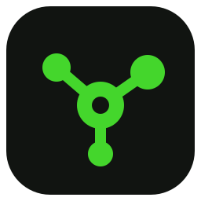
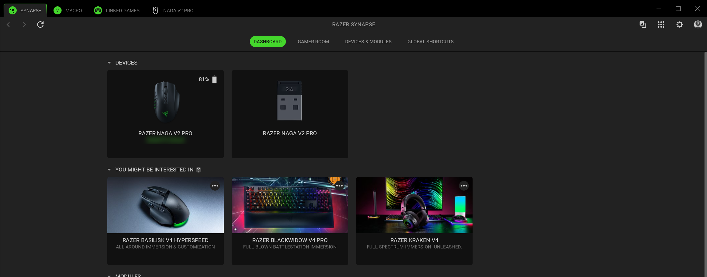
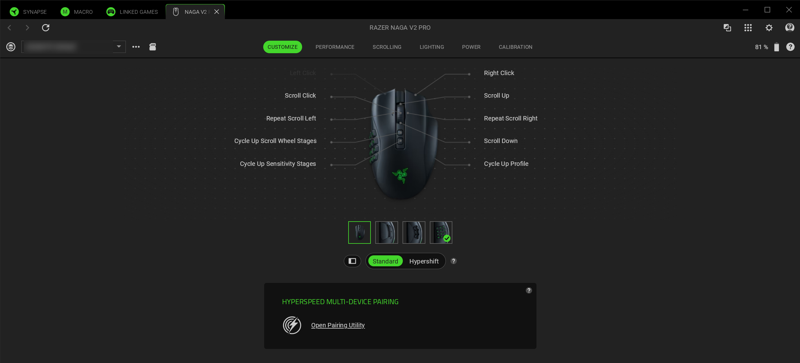
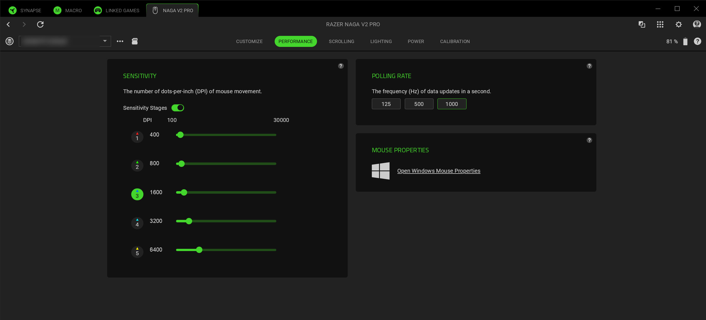

<div align="center">



<h1>Razer Synapse on Linux</h1>

**Razer Synapse 4 via Wine** — the official app, installed by Razer's own installer,
configuring your Razer hardware directly.

[-44d62c?style=flat-square&labelColor=1c1c1e)](WINE_VERSION)
[](#licensing)

[**Install**](#install) · [What works](#what-works) · [Start on login](#start-on-login) · [Build it yourself](#building-it-yourself) · [Troubleshooting](docs/troubleshooting.md)

</div>

<br>

This repository contains the Wine patches and the launcher that make Razer Synapse work on
Linux: the patches so it finds your devices and talks to them over HID the way it does on
Windows, and the launcher that sets up a prefix Razer's installer will run in.

Nothing of Razer's is in here. The first run downloads Razer's installer from Razer, and
you install Synapse from it exactly as you would on Windows — so you always get the
current Synapse, and its updates come from Razer as usual.

<br>



<sub>**The dashboard** — a Naga V2 Pro and its HyperSpeed receiver, found over HID with the
battery level read from the mouse.</sub>

| Customize | Performance |
| --- | --- |
|  |  |

<sub>Both pages show what is read from the mouse; changes on Performance are written back to it.</sub>

---

## Install

**1. Install the Flatpak.** Build it as below, or download `synapse-linux.flatpak` from
a release, then:

```bash
flatpak install --user synapse-linux.flatpak
```

**2. Install the udev rule.** This is the one step that needs root, and one you cannot skip.

Razer devices stay owned by `root` until a udev rule says otherwise — without this Synapse
starts and finds no devices.

```bash
flatpak run --command=razer-synapse-setup io.github.adds39939.SynapseLinux --udev-rule \
  | sudo tee /etc/udev/rules.d/60-razer-synapse.rules >/dev/null

sudo udevadm control --reload-rules
sudo udevadm trigger --subsystem-match=hidraw --subsystem-match=usb
```

If you use OpenRGB, its rule already covers Razer's vendor id.

**3. Start it**, from your application menu or with:

```bash
flatpak run io.github.adds39939.SynapseLinux
```

The first run takes several minutes before anything Razer appears: it builds the Wine
prefix and installs Microsoft's core fonts and .NET Framework 4.8, which Razer's installer
needs — all downloaded from Microsoft. Then Razer's installer opens. Choose **Install** for
Razer Synapse, as you would on Windows; Synapse starts when it has finished.

### Where everything lives

Everything the app writes is in one directory,
`~/.var/app/io.github.adds39939.SynapseLinux/`: the Wine prefix, and with it Synapse, its
settings, profiles and logs.

## Uninstall

```bash
flatpak uninstall --delete-data io.github.adds39939.SynapseLinux
```

## What works

Verified with a **Naga V2 Pro** on its HyperSpeed receiver (`1532:00a8`):

* ✅ **Razer's installer** — the current one, from Razer, installs Synapse 4 and the App
  Engine it runs on
* ✅ **Synapse's own module install** — the drivers, lighting and mapping engines it
  fetches after first start
* ✅ **The mouse and its receiver are detected**, with a battery level that updates live
* ✅ **Device settings are read from the mouse** — sensitivity stages, polling rate,
  which side plate is fitted, lighting brightness and effect
* ✅ **Changes are written back to the mouse** — a polling rate set in Synapse is what
  OpenRazer reads back from it, and the mouse acknowledges each change
* ✅ **Lighting** — effects chosen in Synapse show on the mouse, as do brightness changes.
  Synapse 4 renders effects itself and streams them to the device, about eleven frames a
  second
* ✅ **Button assignments** — a side button set to another key sends that key everywhere
  on the desktop, while Synapse runs and after it quits. The mouse's own firmware applies
  them: Synapse stores every assignment on the mouse, and this build keeps the mouse in
  normal mode so it uses them (see [patch 25](docs/wine-fixes.md))
* ✅ **Display scaling** matches your desktop's, so it is not tiny on a 4K panel

## Untested

* ❓ **Macros.** Synapse reports on-board macro memory for the Naga V2 Pro, so a macro
  may be stored on the mouse and work like any other assignment; none have been tried.
* ❓ **Hypershift** assignments, and the Scrolling, Power and Calibration pages.
* ❓ **The Naga V3 Pro** (`1532:00e8`) is found and connected: Synapse installs its
  module and reads its serial number, and the mouse acknowledges each command and stays
  in normal mode. Lighting and button assignments on it have not been checked by eye yet.
* ❓ **Any other Razer device.** Nothing here is specific to the Nagas — the fixes are to
  device enumeration and Windows features Synapse relies on — so other devices may well
  work, but none have been tried.
* ❓ **Firmware updates.** Nothing here has ever written firmware to a device.

## What doesn't

* 🚫 **Assignments only Synapse itself can carry out** — launching a program, typing text,
  Windows shortcuts. On Windows these go through Razer's filter driver, which Wine cannot
  load, and what Synapse sends from inside Wine would reach only Windows programs.
  Building that is possible but a project of its own; [`docs/wine-fixes.md`](docs/wine-fixes.md)
  has what it would take.
* 🚫 **Razer Game Manager Service** crashes under Wine: it detects games through Windows'
  kernel event tracing, which Wine does not implement. It serves Linked Games and Cortex,
  not devices.

## Start on login

Synapse's own *start with Windows* setting controls this, and it is on by default, as on
Windows: the launcher mirrors it onto an autostart entry each time Synapse starts and
stops. Synapse then starts in the tray. Quit Synapse first, then:

```bash
flatpak run --command=razer-synapse-autostart io.github.adds39939.SynapseLinux status
flatpak run --command=razer-synapse-autostart io.github.adds39939.SynapseLinux remove   # or add
```

## Display scaling

The launcher matches Wine's DPI to your desktop's, from the `Xft.dpi` your desktop gives
its X clients. If it guesses wrong, set it:

```bash
flatpak override --user --env=RAZER_SYNAPSE_SCALE=1.5 io.github.adds39939.SynapseLinux
```

## Notes

* **OpenRazer** can be installed alongside. Both talk to the device over the same
  channel, so while both run, one may read the other's replies; Synapse re-reads the
  device as it starts. Stop the daemon while Synapse runs if you want Synapse to own the
  device.
* Closing Synapse's window sends it to the tray, as on Windows. Quit it from the tray menu.
* What each Wine patch fixes, and why, is written up in
  [`docs/wine-fixes.md`](docs/wine-fixes.md).

## Building it yourself

```bash
flatpak install -y flathub org.freedesktop.Platform//25.08 \
    org.freedesktop.Sdk//25.08 org.freedesktop.Sdk.Extension.mingw-w64//25.08

flatpak-builder --user --install --force-clean \
    build-dir flatpak/io.github.adds39939.SynapseLinux.yml
```

That downloads Wine, applies every patch in `patches/`, builds it against the mingw-w64
SDK extension, and installs the result. It takes a while — most of it is Wine. Nothing
else has to be installed: the runtime and the SDK carry the compilers and the libraries.

The patches are `-p0` patches against Wine 11.16 as upstream ships it: 01–26 are what
Synapse needs, and 27–30 cut how much memory it takes. To build against a different Wine,
change the `url` and `sha256` in the manifest's `wine` module and put the same version in
[`WINE_VERSION`](WINE_VERSION) — CI checks the two agree.

Patches 21–24 and 26 are not Synapse-specific: they fix gaps that affect any application
that walks its child processes, verifies MSIX packages, pairs a USB device with its HID
interfaces, shrinks a window to nothing, or lists HID devices hidapi's way after one has
been unplugged. 25 is the exception, by design — it keeps Razer devices in the mode their
firmware applies their own assignments in, which only makes sense where no Razer filter
driver can run.

## Licensing

This repository's scripts, patches, manifest and docs are MIT (see `LICENSE`).

The Wine inside the Flatpak bundle is compiled from patched Wine sources and is therefore
an **LGPL-2.1-or-later** derivative work of Wine — see `NOTICE` for the
corresponding-source pointers. It is built from the manifest and the patches in this
repository, and no binaries are committed here.

No Razer code or artwork is redistributed here — the app downloads Razer's installer from
Razer, and the icon is this project's own. "Razer" and "Synapse" are Razer's trademarks;
this project is unaffiliated with Razer and not endorsed by it.
